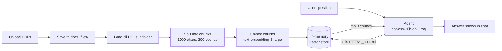

# PDF-Based RAG Chatbot — Python and Streamlit

A small Streamlit app that lets you upload PDF files and ask questions about them. An AI agent answers by retrieving the most relevant passages from your documents first, instead of relying only on what the language model already knows.

## The problem it addresses

Finding a specific answer inside one or more long PDFs usually means opening each file and searching by hand. This app lets you ask in plain language and get an answer grounded in the text of the files you uploaded. If the retrieved text doesn't contain the answer, the agent is instructed to say so rather than make something up.

## Main features

What is implemented in `main.py`:

- **Multi-file PDF upload** through the Streamlit file uploader.
- **Document processing**: PDFs are loaded, split into overlapping chunks, embedded, and stored in a vector store.
- **Retrieval tool for an agent**: the agent has one tool, `retrieve_context`, that returns the 3 most similar chunks for a query.
- **Grounded answers**: the system prompt tells the agent to always call the retrieval tool for questions about the documents, base answers on what it returns, and say so when the information isn't available.
- **Conversation memory within a session**: the agent is built with an in-memory checkpointer, so follow-up questions see earlier turns.
- **Chat interface** built with Streamlit's chat components, with the message history re-rendered on each interaction.

## Technologies and libraries

| Purpose | Library / service |
|---|---|
| Web UI | [Streamlit](https://streamlit.io/) |
| Agent construction | LangChain (`langchain.agents.create_agent`) |
| Agent memory | LangGraph (`InMemorySaver`) |
| PDF loading | `langchain-community` (`PyPDFDirectoryLoader`) with `pypdf` |
| Text splitting | `langchain-text-splitters` (`RecursiveCharacterTextSplitter`) |
| Embeddings | OpenAI `text-embedding-3-large` via `langchain-openai` |
| Vector store | LangChain `InMemoryVectorStore` |
| Chat model | `openai/gpt-oss-20b` served by Groq via `langchain-groq` |
| Configuration | `python-dotenv` |

## How the RAG workflow operates



Step by step:

1. **Upload.** The user selects one or more PDFs. Each file is written to the local `docs_files/` folder.
2. **Load.** `PyPDFDirectoryLoader` reads the PDFs in that folder into LangChain documents.
3. **Chunk.** `RecursiveCharacterTextSplitter` splits the documents into chunks of 1000 characters with 200 characters of overlap.
4. **Embed and index.** Each chunk is embedded with OpenAI's `text-embedding-3-large` and stored in an `InMemoryVectorStore`.
5. **Build the agent.** A Groq-hosted chat model is wrapped with the `retrieve_context` tool, a system prompt, and an `InMemorySaver` checkpointer.
6. **Ask.** When the user asks a question, the agent calls `retrieve_context`, which runs a similarity search (`k=3`) and returns the matching text.
7. **Answer.** The model writes its answer from that retrieved context, and the reply is shown in the chat.

## Installation

Requires **Python 3.11 or newer** (Streamlit's minimum) and your own API keys for OpenAI and Groq.

```bash
git clone <your-repository-url>
cd pdf-rag-chatbot

python -m venv .venv
source .venv/bin/activate        # Windows: .venv\Scripts\activate

pip install -r requirements.txt
```

## Configuring API keys

The app needs two keys, read from environment variables:

| Variable | Used for |
|---|---|
| `OPENAI_API_KEY` | Embeddings (`text-embedding-3-large`) |
| `GROQ_API_KEY` | The chat model (`openai/gpt-oss-20b`) |

Copy the template and fill in your own values:

```bash
cp .env.example .env             # Windows: copy .env.example .env
```

Then edit `.env`. The `.env` file is listed in `.gitignore` and must never be committed.

## Running the app

```bash
streamlit run main.py
```

Open the local URL Streamlit prints (usually http://localhost:8501), upload one or more PDFs, wait for processing to finish, and start asking questions.

## Project structure

```
pdf-rag-chatbot/
├── main.py            # Streamlit app + RAG pipeline + agent
├── requirements.txt   # Python dependencies
├── .env.example       # Placeholder environment variables (no real keys)
├── .gitignore
├── docs_files/        # Uploaded PDFs are saved here (contents are git-ignored)
└── README.md
```

## Known limitations of the current implementation

These describe how the code behaves today:

- **Everything in `docs_files/` is indexed.** The loader reads the whole folder, and the app never clears it, so PDFs from earlier uploads are included in later runs.
- **One fixed conversation thread.** The agent is invoked with the thread ID `"session_123"` for every user, so conversation memory is shared by all sessions served by the same running process.
- **No persistence.** The vector store lives in memory and is rebuilt (and re-embedded) on every upload; restarting the app discards it.
- **One upload round per session.** After processing, the uploader is hidden; uploading different files requires a new session.
- **No source citations.** Answers don't show which file or page the text came from, although the retrieved chunks carry that metadata.
- **Text-based PDFs only.** There is no OCR, so scanned PDFs without a text layer won't yield usable content.
- **Fixed retrieval settings.** Chunk size, overlap, and `k` are hard-coded.

## Possible improvements (not implemented)

- Show source file and page number with each answer.
- Clear or isolate `docs_files/` per session, and generate a unique thread ID per session.
- Persist the index in a vector database so documents don't need to be re-embedded.
- Move PDF loading to a standalone integration package, since `langchain-community` now emits a deprecation notice.
- Add automated tests and a small evaluation set for answer quality.

## Verification status

I (Claude) inspected the code and ran these checks in a clean virtual environment on Python 3.12, using the pinned versions in `requirements.txt`:

- `main.py` compiles, and every import resolves.
- `create_agent` accepts the arguments the code passes (`model`, `tools`, `system_prompt`, `checkpointer`).
- The load → split → vector store → similarity-search path runs on a generated sample PDF, using **fake stand-in embeddings** rather than OpenAI's.
- The Streamlit app starts and renders its upload screen without errors.

**Not tested:** live calls to OpenAI and Groq, and the full upload → question → answer flow, because those need real API keys. Run the app with your own keys to confirm end-to-end behaviour. No performance, accuracy, or user-feedback figures are claimed anywhere in this project.

## Change from the original code

The only functional change is in `main.py`: `os.makedirs("./docs_files/", exist_ok=True)` before saving uploads, so the app doesn't fail if the folder is missing (Git doesn't track empty folders). The rest is the original logic with its indentation restored.
